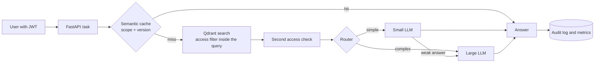
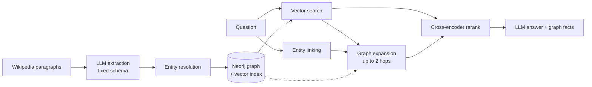

# Production RAG Platform

A retrieval-augmented generation (RAG) service built the way a company would need it: **secure** (multi-tenant access control), **cost-aware** (semantic cache and model routing), and **smarter on hard questions** (a GraphRAG module for multi-hop questions). Every claim below comes from a script in this repo that you can rerun.


## At a glance

| Capability | What was built | Measured result |
|---|---|---|
| Baseline RAG | Chunking, local embeddings, Qdrant search, cited answers, automated LLM-judge evaluation | **96.3%** retrieval hit rate, **87%** answer correctness (54 questions) |
| Security | JWT login, tenant/role/user filters inside the vector search, second access check, append-only audit log | **240** adversarial user-and-query checks (prompt injection, cross-tenant attacks): **0 leaks**; filtering adds **0.1 ms**; answer quality unchanged |
| Cost | Small/large model routing with escalation, two-stage semantic cache, Streamlit dashboard | **49%** lower simulated LLM cost, quality unchanged (83.3% vs 83.3%); cache hits answer in **~50 ms** |
| Multi-hop questions | GraphRAG: LLM entity extraction, entity resolution, Neo4j graph, hybrid retrieval with reranking | F1 **0.59 → 0.76**, both key paragraphs retrieved **67% → 93%** (60 HotpotQA questions), no loss on single-hop |

## Contents
1. [Architecture](#architecture)
2. [Part 1: Baseline RAG and evaluation](#part-1-baseline-rag-and-evaluation)
3. [Part 2: Permission-aware multi-tenant retrieval](#part-2-permission-aware-multi-tenant-retrieval)
4. [Part 3: Semantic cache and cost-aware routing](#part-3-semantic-cache-and-cost-aware-routing)
5. [Part 4: GraphRAG for multi-hop questions](#part-4-graphrag-for-multi-hop-questions)
6. [Limitations](#limitations)
7. [How to run](#how-to-run)
8. [Repository layout](#repository-layout)

## Architecture

**Request flow of the API (`/ask`)**



**GraphRAG module (separate pipeline, evaluated on HotpotQA)**



**Stack:** Python, FastAPI, Qdrant, Neo4j, sentence-transformers, Groq-hosted LLMs (`gpt-oss-120b` large, `gpt-oss-20b` small), PyJWT, SQLite, Streamlit, Docker Compose, pytest, GitHub Actions.

## Part 1: Baseline RAG and evaluation

- **Data:** 18 fictional documents for 3 companies (Acme Corp, Globex Health, Initech Labs): handbook, product FAQ, IT policy, runbook (public/internal) and salary bands, board notes (confidential). The documents are written by an LLM and checked by hand.
- **Pipeline:** 350-word chunks with 60-word overlap, `all-MiniLM-L6-v2` embeddings (local), Qdrant top-5, an LLM answers with chunk citations.
- **Evaluation:** 54 questions with reference answers. A script scores every question (an LLM judge for correctness, plus a document-level retrieval hit) and saves a CSV.
- **Result:** retrieval hit rate **96.3%** (52/54), answer correctness **87%** (47/54).
- **Failure analysis:** 6 of the 7 wrong answers were "I don't know" (the right chunk was not in the top 5). Only 1 was a real mix-up between two similar numbers.

## Part 2: Permission-aware multi-tenant retrieval

Every chunk carries `tenant_id`, `allowed_roles` and `allowed_users`. Four test users per company (employee, manager, hr, admin); the manager is also named personally on the salary document.

| Threat | Defense |
|---|---|
| User claims another tenant or role in the request | Identity comes **only** from the verified JWT; extra fields in the body are ignored |
| Forbidden chunks reach the LLM | Access rules are applied **inside** the vector search (pre-filter), not after it |
| A bug in the filter | A second check in application code drops any forbidden chunk and raises an alert |
| "Who read this document?" | Append-only audit log (database triggers block UPDATE and DELETE) and an admin endpoint |
| A permission is revoked | Updates every chunk of the document; the very next query can no longer retrieve it (tested) |
| Prompt injection ("ignore your filters") | The filter is outside the model's control; tested with attack queries |

**Verification:** a pytest suite runs 20 adversarial queries (cross-tenant, higher-classification, prompt injection) for each of 12 users, i.e. **240 checks**, asserting that no forbidden document is ever retrieved. Result: **0 leaks**, and the access filter adds about **0.1 ms** to a search (median 8.8 ms without it, 8.9 ms with it). The whole project has a 48-test pytest suite. Answer quality through the secured pipeline matches the baseline (hit rate 0.963, correctness 0.87). The tests also check that legitimate access is not over-blocked.

## Part 3: Semantic cache and cost-aware routing

**What it does:** a cache answers repeated questions without calling the LLM; a router sends simple questions to a small model and escalates weak answers to the large one.

**Cache safety rules**
- A cache entry is only served to a user with the **same access scope** (tenant and roles; people with personal document grants get a private scope), so an admin's answer is never shown to an employee.
- Every entry is tagged with a **corpus version**. Re-ingesting documents or changing a document's permissions bumps the version and invalidates everything. There is also a 24-hour expiry.
- "I don't know", empty and source-less answers are never cached.

**The key finding: embedding similarity alone cannot be made safe.** I wrote 54 paraphrase pairs and 54 adversarial near-miss pairs (same wording, different answer), plus 459 real pairs of different questions from the evaluation set.

| Cache check | Paraphrases cached | False hits on near-misses | False hits on real questions |
|---|---|---|---|
| Vector similarity only (threshold 0.85) | 90.7% | 46 of 54 | 0 of 459 |
| + number guard (L4 vs L5, Q3 vs Q4) | 85.2% | 30 of 54 | 0 of 459 |
| + cross-encoder duplicate-question verifier at 0.80 | 74.1% | 4 of 54 | 0 of 459 |
| + verifier at 0.99 (**chosen, safest**) | 11.1% | **0 of 54** | 0 of 459 |

The verifier still scores "revenue" vs "net income" at 0.99 and "minimum" vs "maximum" password length at 0.98, so it cannot separate attribute swaps. I chose the safe setting. As a result the cache behaves mostly as an **exact-repeat cache** with a safety layer (about 87% of exact repeats were served from the cache in the replay; reworded questions were not).

**Router check:** the rule-based router (question length, comparison and explanation keywords, number of clauses, spread of retrieval scores) separated 54 single-fact questions from 40 multi-part questions with 100% accuracy on 94 labelled queries. The multi-part questions were written for this test and contain obvious cue words, so real traffic would be harder; treat this as a sanity check, not a benchmark.

**Replay experiment:** 30 questions asked three ways (original, reworded, repeated) = 90 requests, run through the baseline (always the large model) and the optimized pipeline.

| Metric | Baseline | Optimized |
|---|---|---|
| Total simulated cost | $0.0463 | $0.0236 (**-49.1%**) |
| Cache hit rate | 0% | 28.9% |
| Answer correctness | 83.3% | 83.3% |
| p50 latency | 1.71 s | 1.74 s |
| p95 latency | 3.97 s | 3.86 s |
| Cache-hit latency | n/a | ~50 ms |
| Small-model answers escalated to the large model | n/a | 19% |


**Reading these numbers honestly**
- Cost fell by about half in three separate runs (49.7%, 50.4%, 49.1%) with no change in quality.
- **Overall latency did not improve.** Only cache hits (29% of requests) are fast, the small model is not faster than the large one on a hosted API, and escalated answers need two calls. The benefit is cost, plus about 50 ms on a cache hit versus about 1.7 s for a normal request.
- Cost is **simulated**: token counts multiplied by example list prices (`config.PRICES`), because the free API tiers charge nothing.
- Latency excludes client-side waiting caused by free-tier rate limits; requests were paced 4 seconds apart. One request in each run stalled for minutes (a hung connection or a paused process); this affects averages but not p50 or p95.
- Nearly all replay traffic was simple one-fact questions (63 of 64 uncached requests used the small model), so the large-model path of the router was barely exercised.

## Part 4: GraphRAG for multi-hop questions

**Problem:** plain vector search often misses the second paragraph a question needs ("Where was the director of film X born?" needs the film paragraph *and* the director paragraph).

**Method**
1. **Data:** 60 HotpotQA "bridge" questions plus their 2 key paragraphs and 3 unrelated paragraphs each (300 paragraphs), plus 30 LLM-written single-hop control questions.
2. **Extraction:** an LLM returns entities and relations in a small fixed schema (7 entity types, 14 relation types), validated with Pydantic. Broken or cut-off answers are repaired or retried.
3. **Entity resolution:** duplicate names are merged ("J. Smith" and "John Smith") with string rules plus embedding similarity. Rules prevent bad merges such as father/son (Jr/Sr), "New York" vs "New York City", or "Apollo 11" vs "Apollo 12". 2,593 names became 2,573 entities.
4. **Graph:** Neo4j with `(:Chunk)-[:MENTIONS]->(:Entity)` and `(:Entity)-[:REL]->(:Entity)`, plus a vector index on chunk embeddings: 2,573 entities, 2,230 relations, 3,045 chunk-entity links.
5. **Hybrid retrieval:** vector search, then entities from the question and from the best chunks seed a graph expansion of up to 2 hops; candidates are merged and reranked with a cross-encoder; the LLM also receives a short list of relevant graph facts.

**Graph coverage:** for 87% of multi-hop questions the two key paragraphs share an entity in the graph (2% more are linked by a relation, 12% are not connected), which caps what graph retrieval can achieve.

**Results (60 multi-hop questions)**

| Method | Exact match | F1 | Support recall | Both key paragraphs found | Cost / query |
|---|---|---|---|---|---|
| Vector RAG (baseline) | 50.0% | 0.592 | 82.5% | 66.7% | $0.00019 |
| Vector + rerank | 55.0% | 0.687 | 90.8% | 81.7% | $0.00019 |
| **GraphRAG (hybrid)** | **61.7%** | **0.764** | **96.7%** | **93.3%** | $0.00025 |

**Single-hop control (30 questions):** exact match 76.7% → 80.0%, F1 0.916 → 0.935, support recall 100% for all methods. The graph does not hurt easy questions.

**Is the gain real?** A paired bootstrap over the 60 questions (10,000 resamples) gives, for GraphRAG versus the baseline, an F1 gain of **+0.172 (95% CI +0.072 to +0.277)**, exact match +11.7 points (CI +3.3 to +21.7) and support recall +14.2 points (CI +8.3 to +20.8). Against reranking alone, GraphRAG still adds **+0.077 F1 (CI +0.009 to +0.154)**. Reranking by itself explains about half of the total F1 gain; the graph adds a smaller, statistically significant improvement on top of it.

**One-time indexing cost:** 300 paragraphs, 137k input and 340k output tokens, about $0.11 at simulated list prices. Per-query cost is about 30% higher than the baseline because more context is sent.

**What still fails (exact match = 0)**
GraphRAG scored exact match 0 on 23 of 60 multi-hop questions, but most are not retrieval failures: both key paragraphs were retrieved for 56 of 60. About 13 of the 23 had a substantively correct answer that exact match rejected for wording or granularity (for example "Paula Patton" vs "Paula Maxine Patton"). Four failed because one required paragraph was never retrieved. About six were reasoning or ambiguity errors with both paragraphs present (for example answering with a religion's name when asked what it is a belief in). All 6 single-hop misses were wording differences (for example "24 delegates" vs "24"). Better answer-format control and reporting F1 alongside exact match matter more than further graph changes. (Counts are my manual reading of the result rows.)

## Limitations

- Everything runs on free API tiers; cost figures are simulated and latency excludes rate-limit waiting.
- The data is fictional (Parts 1 to 3) or a small HotpotQA sample (Part 4: 60 multi-hop and 30 single-hop questions, 300 paragraphs, only 3 unrelated paragraphs per question), which is easier than real-world retrieval. LLM-written questions and the LLM judge add noise.
- The semantic cache is safe but conservative: reworded questions are mostly not cached, because the off-the-shelf duplicate-question verifier cannot separate attribute swaps such as "revenue" and "net income". A domain-tuned verifier or a small-LLM check is the next step.
- Login uses one shared demo password; a real system would hash per-user passwords. A role change takes effect only when the user's token expires (60 minutes). The audit log is SQLite.
- Entity resolution is name-based and cannot separate two different people with the same name; 7 of 60 questions had no graph link between their key paragraphs.
- The GraphRAG module runs on its own HotpotQA experiment and is not wired into the permission-aware API. A question-decomposition variant is implemented but not evaluated in this report.
- Cache replay traffic was almost entirely simple questions.

## How to run

**Requirements:** Python 3.11+, Docker, a free [Groq API key](https://console.groq.com/keys).

```bash
git clone https://github.com/VishalTheTechie/Production-Rag-Platform.git
cd Production-Rag-Platform
python -m venv .venv
.venv\Scripts\activate          # Mac/Linux: source .venv/bin/activate
pip install -r requirements.txt
cp .env.example .env            # Windows: copy .env.example .env, then add your key
docker compose up -d            # Qdrant
```

**Parts 1 and 2: baseline, security**
```bash
python generate_docs.py         # creates the fictional documents (LLM calls, resumable)
python ingest.py                # chunk, embed, store with access metadata
python make_eval_set.py         # then review eval/questions.json by hand
python run_eval.py baseline     # baseline numbers
uvicorn main:app --reload       # API docs at http://localhost:8000/docs
pytest -v                       # includes the 240 adversarial leakage checks
python leakage_report.py        # leak count and filtering overhead
python run_eval_secure.py project2
```
Log in at `/login` as, for example, `acme_corp_employee` (password from `DEMO_PASSWORD`, default `demo123`), then use the token in **Authorize**.

**Part 3: cache and routing**
```bash
python make_cache_pairs.py      # paraphrase and near-miss pairs; review data/cache_pairs.json
python tune_threshold.py        # vector-only threshold sweep
python tune_verifier.py         # guard and verifier sweep
python eval_router.py           # router accuracy on labelled queries
python run_compare.py 30        # 90-request replay (resumable)
python report.py                # comparison table
streamlit run dashboard.py      # cost / cache / latency dashboard
```

**Part 4: GraphRAG**
```bash
docker compose -p graphrag-neo4j -f docker-compose.neo4j.yml up -d   # wait about a minute
python -m graphrag.check_neo4j
python -m graphrag.build_corpus
python -m graphrag.make_single_hop      # review graphrag/data/questions.json
python -m graphrag.extract              # slow, resumable
python -m graphrag.resolve              # review graphrag/data/merges.txt
python -m graphrag.load_graph
python -m graphrag.graph_coverage
python -m graphrag.evaluate baseline    # then: rerank, hybrid
python -m graphrag.report
python -m graphrag.significance
```

Key settings live in `.env` (see `.env.example`): `PROVIDERS=groq`, `GROQ_LARGE`, `GROQ_SMALL`, `CACHE_THRESHOLD=0.85`, `VERIFY_THRESHOLD`, `JWT_SECRET`.

## Repository layout

```
main.py, auth.py, acl.py, audit.py     API, JWT login, access rules, audit log
rag.py, pipeline.py, router.py         retrieval, request flow, model routing
cache.py, verifier.py, corpus.py       semantic cache, duplicate-question verifier, versioning
llm.py, embeddings.py, metrics.py      LLM client (rate-limit aware), embeddings, cost/latency log
ingest.py, generate_docs.py            data creation and ingestion
run_eval*.py, run_compare.py, report.py, tune_*.py, eval_router.py, leakage_report.py, dashboard.py
graphrag/                              GraphRAG module (extraction, resolution, Neo4j, evaluation)
tests/                                 access control, cache, GraphRAG unit tests
data/, eval/, graphrag/data/           documents, question sets, results
```

## Author

Vishal Nagare, [GitHub](https://github.com/VishalTheTechie). Dataset: [HotpotQA](https://hotpotqa.github.io/) (Yang et al., 2018).
